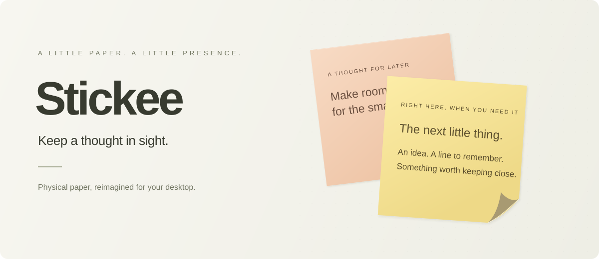

  

  <strong>Physical paper, reimagined for your desktop.</strong> 
  A Windows-first desktop app for thoughts that deserve to stay in view.

  <a href="#why-stickee">Why Stickee</a> ·
  <a href="#paper-with-a-little-life">The feel</a> ·
  <a href="#what-you-can-do-today">Features</a> ·
  <a href="#where-were-heading">What's next</a> ·
  <a href="docs/PROGRESS.md">Progress</a>

---

## Why Stickee?

A thought arrives while you're doing something else. A sentence to keep, a detail to check, the next small step. You put it in a document, a tab, or a notes app—and it disappears behind the rest of your work.

A paper sticky note solves that quietly. It stays where you put it. You can glance at it without opening anything, move it without reorganizing your workspace, and keep the thought close until you're done with it.

**Stickee brings that presence to your screen.** Each note is its own piece of digital paper, designed to sit above ordinary applications and remain within reach while you work.

## Paper with a little life

The feeling matters as much as the text.

Grab a note and its free edge bends behind the movement. Where you hold it changes how it bows. Change direction and the paper leans with you; a corner gradually uncurls, flattens, and curls up on the other side. Release it and the movement settles softly.

Soft shadows, warm paper, and a curved underside give each note a little depth. Controls step aside while you're dragging and return on the flat side, away from the curl. Longer thoughts scroll with a faint hint that there's more to read.

The aim is simple: **paper that feels light in your hand and quiet on your screen.**

## What you can do today

| | |
| --- | --- |
| **Capture a thought** | Create a blank note with **Ctrl+Alt+N** (configurable), from the tray, or from another note. |
| **Put it where it belongs** | Move independent, frameless notes around your desktop and overlap them naturally. |
| **Keep writing** | Edit plain, multiline text with selection, copy, paste, and scrolling. |
| **Find a thought** | Search and browse visible, hidden and trashed notes in the main Stickee window. |
| **Find your paper** | Find on desktop briefly highlights a note where it is. Move here brings it to the collection window's display. |
| **Tidy up together** | Select several notes to show, hide, move to Trash or restore them together. |
| **Load a set** | Group existing notes into named sets and show them alongside notes already on the desktop. |
| **Make it yours** | Choose a default paper colour, Rustle or Click & drop sounds, and record a create shortcut in Preferences. |
| **Keep a way back** | Move notes to Trash, undo or restore later. Permanent deletion asks for confirmation. |
| **Clear some space** | Hide a note or hide them all. Bring them back through the tray when you need them. |
| **Pick up where you left off** | Local autosave preserves text, placement, orientation, and visibility across restarts. |
| **Keep the desktop accessible** | Shaped native windows allow input outside their paper region to reach the application beneath. A small shadow fringe remains interactive. |

### A few small gestures

- **Tray > Open Stickee** - open your note collection. Closing it keeps desktop notes running.
- **Ctrl+Alt+N** — a fresh note near your pointer.
- **Grab the top edge** — move the paper without disturbing text selection.
- **Hover or focus** — reveal New and Hide controls.
- **Right-click** — access editing commands and note actions.
- **Alt+F4** — tuck a note away. Use **Show All** in the tray to bring it back.

## Your thoughts stay on your computer

Stickee currently stores notes locally, with automatic saving and a backup of the previous valid save. It requires no account and includes no cloud sync or analytics service.

Hiding a note keeps its contents. If a save fails, Stickee reports the problem and blocks a normal quit so you can address it. Recent edits can still be lost if the process is forcibly stopped before a save completes.

## Where we're heading

The first priority is getting the everyday paper experience right: reliable visibility, responsive movement, readable text, and dependable saving.

| Next | Direction |
| --- | --- |
| **Preserve the paper** | The approved motion, entrance and curated palette stay intact. |
| **Make it dependable** | Broader Windows testing across focus changes, overlapping windows, displays, and scaling; accessibility and reversible deletion. |
| **Polish the collection** | The main app is implemented; review its design and everyday behavior with the complete Windows acceptance pass. |
| **Prepare for release** | Packaging, distribution, and testing the installed Windows experience. |
| **Explore further** | Separate macOS feasibility work and a later decision about whether user profiles would be useful. |

The manager and preferences are implemented, with native acceptance pending. Profiles and macOS support remain **planned or exploratory**. Accounts and sync are outside the current scope.

## Still taking shape

Stickee is in active development. The desktop foundation is implemented, and the paper interaction has been shaped through hands-on feedback. It is not yet a release-ready product.

Windows focus and always-on-top behavior, animated edge hit testing, mixed-DPI displays, and packaged builds still have verification work ahead. The illustration above conveys the visual direction; it is not an application screenshot.

Follow the [phase tracker](docs/PROGRESS.md) for what is implemented, what remains, and which checks have actually run. The [implementation plan](STICKEE_IMPLEMENTATION_PLAN.md) describes the full direction; [feasibility notes](docs/FEASIBILITY.md) record the native-window tradeoffs.

---

  Built with Electron, React, and TypeScript. 
  Windows first. Local notes. A little room for your thoughts.

